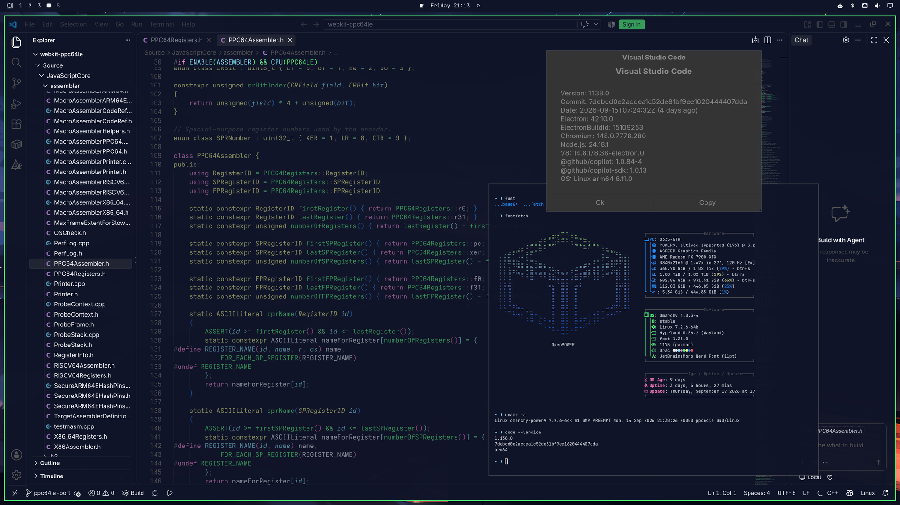

  <picture>
    <source media="(prefers-color-scheme: dark)" srcset="docs/powerarm/assets/logo/powerarm-lockup-horizontal-dark.png">
    
  </picture>


[](LICENSE)
-2f4f7f)


**Run AArch64 Linux programs on POWER.** POWERarm is a user-mode emulator for **ppc64le** hosts
(POWER8 and later). It translates AArch64 machine code to POWER machine code at run time, runs
programs from an AArch64 root filesystem, and can register with `binfmt_misc` so AArch64 binaries
start like native ones.

## Status

**Experimental.** Correctness is checked instruction by instruction and program by program
against a real Cortex-A76 (Raspberry Pi 5), on both 64K and 4K page-size POWER kernels.

| Milestone | State |
|---|---|
| **M1:** static AArch64 programs (glibc and musl, busybox, TinyCC) | ✅ output identical to the reference |
| **M2:** Arch Linux ARM's own GCC builds zlib and Lua | ✅ every object and binary byte-identical to the reference |
| Optimization round 1 (branches, register use, code shape, translation speed, code cache, startup) | ✅ merged |
| NEON SIMD optimizations (vectorized shifts, 64-bit VMov, unsigned compares, pairwise reductions, ISA 3.0 vabsdu*, native SQDMULH, vector-scan branch fusion, hardware vector FP16 xvcvhpsp/xvcvsphp) | ✅ merged; exact POWER9 lowerings with verified POWER8 fallbacks |
| Larger real-world programs: JIT-based language runtimes | ✅ the aarch64 Claude Code CLI (Bun / JavaScriptCore) runs day to day, and code-server 4.137 (VS Code on Node 24 / V8) serves its workbench and runs its extension host |
| Desktop apps: VS Code | ✅ Microsoft's arm64 VS Code 1.138 (Electron 42, Chromium 148, Node 24): the workbench, extensions and the integrated terminal. Chromium's sandbox is off (`--no-sandbox`) for now |
| GPU | ✅ Vulkan and OpenGL run unthunked through the guest's own Mesa (RADV, radeonsi). `vkcube` matches the native frame rate |
| Games | ✅ SuperTuxKart, Arch Linux ARM's aarch64 build, runs its benchmark at around 100 fps on an RX 7900 XTX. MangoHud for guests shows frame rate, GPU load and live JIT statistics |
| Two-tier root filesystem | ✅ a read-only base plus a per-user writable layer; the guest's own `pacman` installs packages into it |
| Library thunks (Vulkan, GL, libc string and math routines) | ✅ guest vDSO (`libVDSO-a64-guest.so`) enabled by default for accelerated clock/time syscalls; guest-to-host thunk call path and callbacks merged |
| Further performance work (code shape, flags, translation speed, code cache coverage) | 🔄 in progress; ranked goals in [`docs/powerarm/research/`](docs/powerarm/research/) |

<p align="center">
  
</p>
<p align="center"><sub>Microsoft's arm64 VS Code on a POWER9 workstation (Omarchy, RX 7900 XTX), editing the
JavaScriptCore PPC64 assembler. The About box reports <code>Linux arm64</code>; <code>uname</code> in the native
terminal beside it reports <code>ppc64le</code>.</sub></p>

**Presented CPU:** Cortex-A76 class, with
`fp asimd aes pmull sha1 sha2 crc32 atomics fphp asimdhp cpuid`. FEAT_LSE atomics are implemented
in full and advertised through `AT_HWCAP`, `ID_AA64ISAR0_EL1` and `/proc/cpuinfo` alike; there is
no SVE or SME. The EL0-readable generic timer (`CNTVCT_EL0`, `CNTFRQ_EL0`) is present, which is
what JavaScript engines use as their high-resolution clock.

## What's new in 0.20.0

A stability and clean-up release. The headline is that POWERarm no longer leaves processes
behind, which was the most visible defect a desktop user could hit.

**Processes left behind, and the cache that went with them.** The code-cache exit-save `fork()`
handed its child one thread and every lock the exiting threads were holding. The child blocked
on the first lock it touched, reparented to init, and sat in a futex for the uptime of the
machine -- and the cache that exit was meant to write was lost with it. Measured on an idle
machine, **35.7% of threaded guest exits** leaked one; 153 were found alive on the development
box, the oldest over four hours. The fix is asymmetric, because the parent cannot reserve those
locks without deadlocking against the exiting threads: the child recovers them from its own
side, and arms a watchdog for any lock nobody enumerated. **Zero survivors over 1728 exits**,
with the cache still written.

**The test suite could not see it, and now can.** `threadexit_loop` reported PASS through
roughly 200 leaked processes across four runs, because the process it waits on exits cleanly
and the orphan is nothing's child. It now counts emulator processes before and after the loop
and fails on any new one. Separately, the two teardown-race tests could wedge the suite
indefinitely rather than report a hang.

**Signals.** A process-directed signal handed to a thread already in its own teardown was
consumed and lost. The kernel is actively likely to pick such a thread, because it chooses the
first in the group that does not block the signal and `PF_EXITING` is not set until long after
teardown begins. Across seven headless Chrome sessions every one lost one to three
kernel-generated `SIGCHLD`, so a guest that installs a handler to reap its children -- which
Chrome does -- never learned the child exited. An exiting thread now blocks asynchronous signals
before it can lose one, so the kernel skips it and the signal reaches a thread that can take it.

**POWER8.** The vector FP16 converts went out to a 246-instruction software helper on POWER8,
and the helper was wrong. Every ISA 3.0 instruction in the emitter is now gated behind runtime
feature detection and linted against leaking into a POWER8 path, with the host assembler as the
oracle instead of a hand-maintained list -- the previous list was wrong three times, and the
lint that checked it was itself scanning two files and verifying nothing in them.

**Build.** `TUNE_CPU=native` probed the x86 spelling of the flag, so a native build got no
tuning at all.

**Code generation.** FMAXNM/FMINNM check their result for a NaN rather than both inputs
(1.74x on the sequence); the vector lane-test idiom branches on CR6 instead of reducing the
mask, now including the `addv` form that is 17x the sites of the one it already accepted; `PRFM`
was a nop and becomes `dcbt`/`dcbtst`; a load and the `REV` beside it become one byte-reversed
access; CCMP/CCMN lower to two compares and one CR logical op; `sra*` serves ASR and SBFX and
`rldicl.` serves TBZ where the carry is dead; `NEG.4S`/`NEG.2D` become one `vnegw`/`vnegd`;
fifteen more vector ops can name the VSX low bank; and the guest's `memset`/`memcpy`/`memmove`
can be redirected to the host's routines, gated and off by default.

**Lowerings are now costed on hardware before they are written.** That rejected four ranked
candidates this cycle rather than shipping them -- the ISA 3.0 atomic memory operations are
**11x slower** than the LL/SC loop they would have replaced, and `setb`, pre-index `stdu` and
the scalar POWER8 half converts are all regressions -- and confirmed the two that shipped. The
`ctrl`+`isync` acquire load was also rejected, by the memory model rather than the clock: it is
a dependency, not a cumulative fence.

## Requirements

- **Host:** a ppc64le POWER8 or newer machine. POWER9 (ISA 3.0) fast paths are selected at run time
  from `AT_HWCAP2`, and every one has a POWER8 fallback.
- **Kernel:** Linux with 4K or 64K pages.
- **Build:** clang (GCC isn't supported for building), CMake, Ninja. See
  [`docs/DEPENDENCIES.md`](docs/DEPENDENCIES.md).

## Build

```sh
git submodule update --init --recursive
CC=clang CXX=clang++ cmake -S . -B build-powerarm -GNinja \
  -DCMAKE_BUILD_TYPE=Release -DBUILD_THUNKS=OFF -DBUILD_TESTING=OFF
ninja -C build-powerarm
```

## Use

1. **Root filesystem.** Build the pinned Arch Linux ARM sysroot, with no root needed. See
   [`Scripts/powerarm/rootfs/README.md`](Scripts/powerarm/rootfs/README.md). It lands in
   `~/.local/share/powerarm/RootFS/ArchLinuxARM-m2/`.
2. **Configuration.** Create `~/.config/powerarm/Config.json`:
   ```json
   { "Config": { "RootFS": "ArchLinuxARM-m2" } }
   ```
3. **Run:**
   ```sh
   POWERarm /usr/bin/uname -m        # prints aarch64
   POWERarm /path/to/aarch64-program
   ```
4. **Optional:** register `binfmt_misc` (needs root) with the generated
   `build-powerarm/Data/binfmts/POWERarm-aarch64.conf`, so AArch64 binaries run directly. The
   entry uses the `F` flag, so re-register after rebuilding.

Options are `POWERARM_*` environment variables or `Config.json` keys. The code cache is on by
default for root filesystem binaries; `POWERARM_ENABLECODECACHINGWIP=0` turns it off.

**Installing more guest software.** A directory `<rootfs>-overlay` next to a root filesystem
(`~/.local/share/powerarm/RootFS/<name>-overlay/`) turns on a per-user
writable layer. Guest `pacman` installs into it, and the base stays unchanged. See
[`Scripts/powerarm/rootfs/README.md`](Scripts/powerarm/rootfs/README.md) and `DESIGN.md` §6.2a.

**Metrics.** With `POWERARM_PROFILESTATS=1`, the emulator publishes live per-thread JIT
statistics. [`Scripts/powerarm/shmstats.py`](Scripts/powerarm/shmstats.py) logs them to CSV,
and [`Scripts/powerarm/mangohud/`](Scripts/powerarm/mangohud/) builds MangoHud for guests with a
panel that shows them in game.

## Documentation

| Document | Contents |
|---|---|
| [`HANDOVER.md`](HANDOVER.md) | current state, working practices and the traps that cost time |
| [`docs/powerarm/DESIGN.md`](docs/powerarm/DESIGN.md) | architecture and design decisions |
| [`docs/powerarm/M1-PLAN.md`](docs/powerarm/M1-PLAN.md), [`M2-PLAN.md`](docs/powerarm/M2-PLAN.md) | milestones, exit criteria, results |
| [`docs/powerarm/OPTIMIZATION-CHECKLIST.md`](docs/powerarm/OPTIMIZATION-CHECKLIST.md) | measured optimization work and queue |
| [`docs/powerarm/CODE-CACHE.md`](docs/powerarm/CODE-CACHE.md) | code cache design and correctness tests |
| [`docs/powerarm/THUNKS-DESIGN.md`](docs/powerarm/THUNKS-DESIGN.md) | library thunks: guest-to-host calls, callbacks, the guest vDSO |
| [`docs/powerarm/research/`](docs/powerarm/research/) | POWER9 pipeline, scalar FP and NEON lowering, cold translation cost and warm code quality research |
| [`unittests/A64Diff/README.md`](unittests/A64Diff/README.md) | differential test harness (64K and 4K KVM) |

## Acknowledgements

POWERarm builds on two projects:

- **[FEX-Emu](https://github.com/FEX-Emu/FEX)** provides the JIT core, IR, Linux emulation layer,
  thunk generator and rootfs tooling. Thanks to Ryan Houdek and all FEX-Emu contributors.
- **[fastppcx86](https://github.com/daedalao/fastppcx86)** provides the PPC64LE JIT backend and code
  emitter, 64K page support, and the self-modifying-code subsystem for POWER.

The A64 decoder table comes from [dynarmic](https://github.com/lioncash/dynarmic) (0BSD); see
[`THIRD_PARTY.md`](THIRD_PARTY.md).

## License

MIT. See [`LICENSE`](LICENSE).

Arm is a trademark of Arm Limited and POWER is a trademark of IBM. POWERarm is an independent
project, not affiliated with or endorsed by either.
